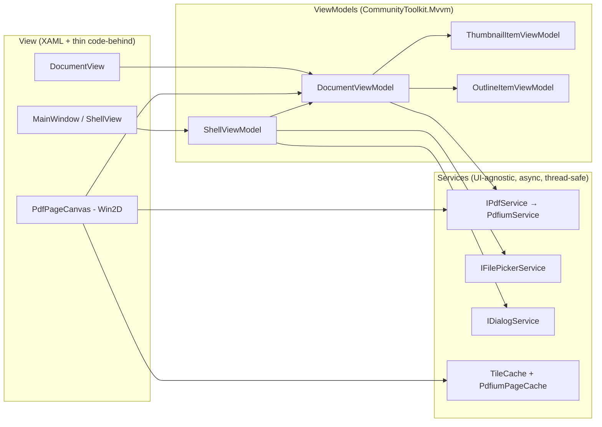

# AGENTS.md — WinPDF engineering guide for AI agents and humans

> **Read this file completely before changing any code.** It is the single source of truth for
> architecture, rendering pipeline, coordinate math, conventions and roadmap. If you change any of
> these, update this file in the same commit.

WinPDF is a modern, lightweight, 100% native PDF reader and annotator for Windows 11, inspired by
the design, UX and feature set of [GNOME Papers](https://gitlab.gnome.org/GNOME/papers), built on
WinUI 3 (Windows App SDK) + C# / .NET 10 (LTS).

---

## 0. Current status

| Step | Scope | Status |
|------|-------|--------|
| 1 | Solution, `.csproj` (unpackaged), `AGENTS.md`, `en-US` / `pt-BR` resources, .NET 10 migration | ✅ Done |
| 2 | Shell: Mica, custom TitleBar, `SplitView` sidebar, `CommandBar`, view-mode selector, MVVM wiring | ✅ Done |
| 3A | `IPdfService` (PDFium, dedicated thread, Zero-LOH/Zero-Copy), coordinate math, LRU caches, lazy sidebar thumbnails | ✅ Done |
| 3B | `PdfPageCanvas` (Win2D), DirectManipulation zoom/pan, hybrid full-page / detail patch, continuous & paged views | ✅ Done |
| 3C | Interactive text selection (`FPDFText_*`), full-document search (`Ctrl+F`), clickable links (`FPDFLink_*`), GPU highlights | ✅ Done (v0.5.0-alpha.5) |
| 4 | Vector annotation layer (ink, highlight, note, eraser), Touch vs. Pen separation, save to PDF | ⏳ Next |

Sections marked **(design)** describe the agreed target design not yet implemented. Turn them into
**(implemented)** with file links when the code lands.

---

## 1. Non-negotiable constraints

1. **Stack:** WinUI 3 (Windows App SDK 1.8.x) + C# + .NET 10 (`net10.0-windows10.0.26100.0`,
   minimum OS `10.0.19041.0`). No WPF, no WinForms, no WebView-based UI.
2. **No paid/proprietary PDF components** (no Syncfusion, DevExpress, Apryse, etc.).
   PDF engine = **PDFium** (`bblanchon.PDFium.Win32` binaries + hand-written P/Invoke).
   GPU drawing = **Win2D** (`Microsoft.Graphics.Win2D`).
3. **MVVM** with `CommunityToolkit.Mvvm` (source generators: `[ObservableProperty]`, `[RelayCommand]`).
4. **Strict Performance & Engineering Hierarchy:**
   - **PRIORITY #1 — Zero Idle Consumption (0.0% CPU / 0% GPU when stationary):** Mandatory for mobile battery life and PSR.
   - **PRIORITY #2 — Minimum CPU Usage during Scroll/Zoom:** Always trade controlled RAM (page/bitmap caches) to avoid CPU display list re-traversals.
   - **PRIORITY #3 — Controlled RAM & Zero-LOH:** Predictable LRU limits; never allocate buffers in the Large Object Heap (> 85 KB).
   - **NON-NEGOTIABLE UI PRESERVATION (UI Freeze):** Never degrade or simplify current native WinUI 3 shell layout (Mica Base, 48 DIPs TitleBar, frame navigation, resizable sidebar, 2-column SettingsView).
5. **Zero hardcoded user-visible strings** in XAML or C#. See §6.
6. **All code, identifiers, comments and commit messages in English.** XML docs (`/// <summary>`)
   on every public/protected type and member (the build emits CS1591 warnings for gaps).

---

## 2. Repository layout

```
WinPDF/
├─ AGENTS.md                    ← this file
├─ README.md
├─ WinPDF.sln                   ← platforms: x64, x86, ARM64 (no AnyCPU)
├─ global.json                  ← .NET SDK 10.0.x (rollForward: latestFeature)
├─ Directory.Build.props        ← shared compiler settings (nullable, docs, analyzers)
├─ Directory.Packages.props     ← Central Package Management (ALL NuGet versions live here)
├─ .editorconfig
├─ tools/
│  └─ Check-Resources.ps1       ← verifies en-US / pt-BR key parity
└─ src/WinPDF/
   ├─ WinPDF.csproj             ← WinUI 3, unpackaged, self-contained WinAppSDK
   ├─ app.manifest              ← PerMonitorV2 DPI awareness
   ├─ App.xaml(.cs)             ← entry point, (Step 2) DI container + activation args
   ├─ MainWindow.xaml(.cs)      ← window shell
   ├─ Properties/launchSettings.json
   ├─ Strings/
   │  ├─ en-US/Resources.resw   ← DEFAULT / fallback language
   │  └─ pt-BR/Resources.resw
   ├─ Helpers/                  ← ResourceStrings, ResourceKeys, small utilities
   ├─ Models/            (S2+)  ← plain records: PdfPageInfo, OutlineItem, PdfTextModels, Annotation models
   ├─ ViewModels/        (S2+)  ← ShellViewModel, DocumentViewModel, PageViewModel, ThumbnailViewModel
   ├─ Views/             (S2+)  ← XAML pages / user controls (no business logic in code-behind)
   ├─ Controls/          (S3+)  ← PdfPageCanvas, SplitterContainer, ThumbnailPresenter
   ├─ Services/          (S3+)  ← IPdfService, PdfiumService, PdfiumEngine, IFilePickerService, IDialogService
   ├─ Rendering/         (S3+)  ← TileCache, PdfiumPageCache, ZoomQuantizer, PageCoordinateTransform
   └─ Interop/Pdfium/    (S3+)  ← [LibraryImport] declarations, SafeHandles, PDFium enums/structs
```

---

## 3. MVVM architecture **(implemented)**



Rules:

- **ViewModels never reference `Microsoft.UI.Xaml.*` types** (except `DispatcherQueue` via an
  injected abstraction). They are unit-testable without a window.
- **Services never touch UI.** They return immutable data (records, byte buffers, `CanvasBitmap`
  is allowed because Win2D resources are device-bound, not thread-bound).
- **DI:** `Microsoft.Extensions.DependencyInjection` configured in `App.xaml.cs`.
  Services are singletons; `DocumentViewModel` is created per open document.
- **Commands:** `[RelayCommand]` (async commands use `AsyncRelayCommand` with cancellation).
- **Observable Properties:** In .NET 10 (C# 13/14) with CommunityToolkit.Mvvm 8.4+, use partial
  property syntax (`[ObservableProperty] public partial T Property { get; set; }`) with XML docs
  `/// <summary>` directly on the property so generated code satisfies `CS1591` without warnings.
- **Code-behind** is allowed only for pure view concerns that cannot be expressed in XAML
  (pointer handling, Win2D draw callbacks, `ScrollViewer.ViewChanged` → forwarded to VM/scheduler).

---

## 4. Rendering pipeline, GPU and touch **(implemented)**

### 4.1 Threads & Idle State

| Thread | Does | Never does |
|--------|------|-----------|
| **UI thread** | Layout, XAML, Win2D draw callbacks (blits cached bitmaps + vector highlights), pointer events | Call PDFium, decode, allocate large bitmaps |
| **Compositor / DManip thread** (system) | Applies pan/zoom transforms to the visual tree on the GPU at display refresh rate | — (not under our control, that is the point) |
| **PDFium render thread** (1, dedicated) | *All* `FPDF_*` calls, rasterization into BGRA buffers, text/search/link queries, save | Touch UI objects, spin-wait, sleep |
| **Thread pool** | `CanvasBitmap.CreateFromBytes` upload to GPU, cache eviction bookkeeping | Call PDFium |

PDFium is **not thread-safe**. `PdfiumService` owns a single long-running thread that consumes
priority channels. Every public `IPdfService` method enqueues a job and returns a `Task`.

**Idle 0.0% CPU & 0% GPU (Priority #1):**
- Prohibited: `CanvasAnimatedControl`, continuous `DispatcherTimer`, polling loops, infinite XAML animations.
- When stationary on screen, `Invalidate()` is **never** called. This allows the CPU to enter Deep
  C-States (C8/C10) and the display panel to activate Panel Self-Refresh (PSR).

### 4.2 Hybrid Level 0 Base, Single Viewport Patch, and GPU Text/Search Highlights

1. **Level 0 Base Bitmap (`ZoomFactor <= 1.01` or background preview):**
   - Render the complete page in **a single rasterization call** at base resolution (1.0x).
   - Displayed via `_baseCanvas` (`CanvasControl`) with `DpiScale = 1.0f` fixed forever.
   - Cached in `TileCache` (`TileKind.FullPage, ZoomStep: 0`). Guarantees no page is ever blank during fast scroll.
2. **High Zoom / Magnification (`ZoomFactor > 1.01`):**
   - Displayed via `_detailCanvas` (`CanvasControl`), positioned over the visible viewport via `_detailTranslate`.
   - On gesture completion (85 ms debounce):
     - Compute visible page intersection `GetVisibleRectInPageDips()`.
     - Expand with 20% prefetch margin.
     - Render in **a single high-priority PDFium call** (`RenderAsync`), capped at 4096 px.
     - Upload `CanvasBitmap` and position `_detailCanvas`.
   - Off-screen pages immediately collapse `_detailCanvas` and release high-res VRAM via `ReleaseHighResPatch()`.
3. **GPU Vector Highlights (`DrawTextOverlays` in `PdfPageCanvas`):**
   - Search match highlights (translucent yellow for page matches, translucent orange + border for active match)
     and interactive text selection (translucent blue with rounded corners) are rendered as Win2D vector primitives
     directly inside `OnBaseCanvasDraw` and `OnDetailCanvasDraw` (after Night Mode bitmap inversion, so highlight
     colors remain legible in both Light and Night Mode with zero extra `CanvasControl` surfaces).
   - Only pages whose selection or active search match changes call `InvalidateOverlays()`, preserving 0.0% idle CPU/GPU.

### 4.3 Caches & Lazy Sidebar Loading

- `PdfiumPageCache`: LRU cache on the PDFium render thread holding the last **8 opened `FPDF_PAGE`
  handles** (`FPDF_LoadPage`) along with their companion lazy `FPDF_TEXTPAGE` (`FPDFText_LoadPage`)
  and `FPDF_PAGELINK` (`FPDFLink_LoadWebLinks`) handles. Companion handles are always disposed
  strictly before `FPDF_ClosePage`. Full-document background search (`SearchDocument`) reuses cached
  handles for visible pages and transiently opens/closes uncached pages so the visible LRU is never flushed.
- `TileCache`: LRU keyed by `(documentId, pageIndex, kind, zoomStep, tileX, tileY, renderFlags, rotation, scalePercent)`,
  bounded by **bytes**.

---

## 5. Coordinate systems and transformation matrices

| Space | Unit | Origin | Y axis |
|-------|------|--------|--------|
| **PDF user space** | point = 1/72 in | bottom-left of MediaBox (CropBox may be offset) | up |
| **Page DIP space** | DIP = 1/96 in | top-left of the visible (cropped) page | down |
| **Content DIP space** | DIP | top-left of the ScrollViewer content (all pages laid out) | down |
| **Viewport DIP space** | DIP | top-left of the ScrollViewer viewport | down |
| **Physical pixels** | px | top-left of viewport | down |

`PageCoordinateTransform` provides `ToPage(Vector2)`, `ToPdf(Vector2)`, `ToPageRect(PdfRect)`, and
`ToPdfRect(Rect)` accounting for `CropBox ∩ MediaBox` origin offsets (`OriginXPt`, `OriginYPt`),
intrinsic page `/Rotate`, and user view rotation (`0°`, `90°`, `180°`, `270°`).

---

## 6. Internationalization

- Resources: `src/WinPDF/Strings/<lang>/Resources.resw`, MRT Core (`Microsoft.Windows.ApplicationModel.Resources`).
- **`en-US` is the default/fallback** (`<DefaultLanguage>` in the csproj). `pt-BR` must have
  **exactly the same keys**. Run `pwsh tools/Check-Resources.ps1` before committing.

---

## 7. Build, run, verify

Prerequisites: Windows 10 19041+ (Windows 11 recommended for Mica), **.NET SDK 10.0.100+**.

```powershell
# Restore + build (x64 is the default platform; x86 / ARM64 also supported)
dotnet build WinPDF.sln -c Debug -p:Platform=x64

# Run (unpackaged, self-contained Windows App SDK)
.\src\WinPDF\bin\x64\Debug\net10.0-windows10.0.26100.0\win-x64\WinPDF.exe [path\to\file.pdf]

# Resource key parity check
pwsh .\tools\Check-Resources.ps1
```
