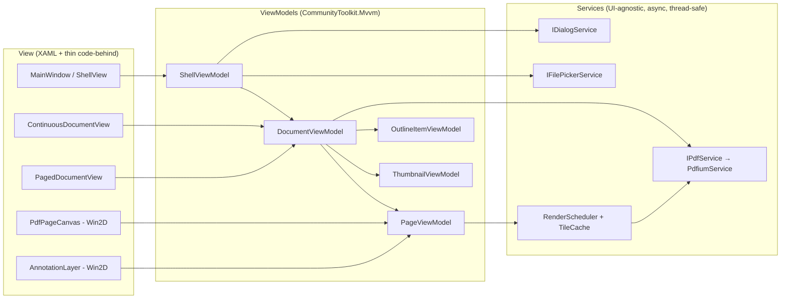

# AGENTS.md — WinPDF engineering guide for AI agents and humans

> **Read this file completely before changing any code.** It is the single source of truth for
> architecture, rendering pipeline, coordinate math, conventions and roadmap. If you change any of
> these, update this file in the same commit.

WinPDF is a modern, lightweight, 100% native PDF reader and annotator for Windows 11, inspired by
the design, UX and feature set of [GNOME Papers](https://gitlab.gnome.org/GNOME/papers), built on
WinUI 3 (Windows App SDK) + C# / .NET 10 (LTS).

---

## 0. Current status

| Step | Scope | Status |
|------|-------|--------|
| 1 | Solution, `.csproj` (unpackaged), `AGENTS.md`, `en-US` / `pt-BR` resources, .NET 10 migration | ✅ Done |
| 2 | Shell: Mica, custom TitleBar, `SplitView` sidebar, `CommandBar`, view-mode selector, MVVM wiring | ✅ Done |
| 3 | `IPdfService` (PDFium, dedicated thread), Win2D page rendering, DirectManipulation zoom/pan, LOD pipeline | ⏳ Next |
| 4 | Vector annotation layer (ink, highlight, note, eraser), Touch vs. Pen separation, save to PDF | ⏳ |

Sections marked **(design)** describe the agreed target design not yet implemented. Turn them into
**(implemented)** with file links when the code lands.

---

## 1. Non-negotiable constraints

1. **Stack:** WinUI 3 (Windows App SDK 1.8.x) + C# + .NET 10 (`net10.0-windows10.0.26100.0`,
   minimum OS `10.0.19041.0`). No WPF, no WinForms, no WebView-based UI.
2. **No paid/proprietary PDF components** (no Syncfusion, DevExpress, Apryse, etc.).
   PDF engine = **PDFium** (`bblanchon.PDFium.Win32` binaries + hand-written P/Invoke).
   GPU drawing = **Win2D** (`Microsoft.Graphics.Win2D`).
3. **MVVM** with `CommunityToolkit.Mvvm` (source generators: `[ObservableProperty]`, `[RelayCommand]`).
4. **Strict Performance & Engineering Hierarchy:**
   - **PRIORITY #1 — Zero Idle Consumption (0.0% CPU / 0% GPU when stationary):** Mandatory for mobile battery life and PSR.
   - **PRIORITY #2 — Minimum CPU Usage during Scroll/Zoom:** Always trade controlled RAM (page/bitmap caches) to avoid CPU display list re-traversals.
   - **PRIORITY #3 — Controlled RAM & Zero-LOH:** Predictable LRU limits; never allocate buffers in the Large Object Heap (> 85 KB).
   - **NON-NEGOTIABLE UI PRESERVATION (UI Freeze):** Never degrade or simplify current native WinUI 3 shell layout (Mica Base, 48 DIPs TitleBar, frame navigation, resizable sidebar, 2-column SettingsView).
5. **Zero hardcoded user-visible strings** in XAML or C#. See §6.
6. **All code, identifiers, comments and commit messages in English.** XML docs (`/// <summary>`)
   on every public/protected type and member (the build emits CS1591 warnings for gaps).

---

## 2. Repository layout

```
WinPDF/
├─ AGENTS.md                    ← this file
├─ README.md
├─ WinPDF.sln                   ← platforms: x64, x86, ARM64 (no AnyCPU)
├─ global.json                  ← .NET SDK 10.0.x (rollForward: latestFeature)
├─ Directory.Build.props        ← shared compiler settings (nullable, docs, analyzers)
├─ Directory.Packages.props     ← Central Package Management (ALL NuGet versions live here)
├─ .editorconfig
├─ tools/
│  └─ Check-Resources.ps1       ← verifies en-US / pt-BR key parity
└─ src/WinPDF/
   ├─ WinPDF.csproj             ← WinUI 3, unpackaged, self-contained WinAppSDK
   ├─ app.manifest              ← PerMonitorV2 DPI awareness
   ├─ App.xaml(.cs)             ← entry point, (Step 2) DI container + activation args
   ├─ MainWindow.xaml(.cs)      ← window shell
   ├─ Properties/launchSettings.json
   ├─ Strings/
   │  ├─ en-US/Resources.resw   ← DEFAULT / fallback language
   │  └─ pt-BR/Resources.resw
   ├─ Helpers/                  ← ResourceStrings, ResourceKeys, small utilities
   ├─ Models/            (S2+)  ← plain records: PdfPageInfo, OutlineItem, Annotation models
   ├─ ViewModels/        (S2+)  ← ShellViewModel, DocumentViewModel, PageViewModel, ThumbnailViewModel
   ├─ Views/             (S2+)  ← XAML pages / user controls (no business logic in code-behind)
   ├─ Controls/          (S3+)  ← PdfPageCanvas, AnnotationLayer, ContinuousDocumentView, PagedDocumentView
   ├─ Services/          (S3+)  ← IPdfService, PdfiumService, IFilePickerService, IDialogService
   ├─ Rendering/         (S3+)  ← TileCache, RenderScheduler, ZoomQuantizer, coordinate transforms
   └─ Interop/Pdfium/    (S3+)  ← [LibraryImport] declarations, SafeHandles, PDFium enums/structs
```

---

## 3. MVVM architecture **(design)**



Rules:

- **ViewModels never reference `Microsoft.UI.Xaml.*` types** (except `DispatcherQueue` via an
  injected abstraction). They are unit-testable without a window.
- **Services never touch UI.** They return immutable data (records, byte buffers, `CanvasBitmap`
  is allowed because Win2D resources are device-bound, not thread-bound).
- **DI:** `Microsoft.Extensions.DependencyInjection` (added in Step 2) configured in `App.xaml.cs`.
  Services are singletons; `DocumentViewModel` is created per open document (future tabs).
- **Commands:** `[RelayCommand]` (async commands use `AsyncRelayCommand` with cancellation).
- **Observable Properties:** In .NET 10 (C# 13/14) with CommunityToolkit.Mvvm 8.4+, use partial
  property syntax (`[ObservableProperty] public partial T Property { get; set; }`) with XML docs
  `/// <summary>` directly on the property so generated code satisfies `CS1591` without warnings.
- **Code-behind** is allowed only for pure view concerns that cannot be expressed in XAML
  (pointer handling, Win2D draw callbacks, `ScrollViewer.ViewChanged` → forwarded to VM/scheduler).
- Main view-model state:
  - `ShellViewModel`: `IsSidebarOpen`, `SidebarTab` (Thumbnails|Outline), `ViewMode`
    (Continuous|Paged), `ActiveTool` (Select|Pen|Highlighter|Eraser|TextNote), `IsTouchDrawingEnabled`,
    `StrokeColor`, `StrokeThickness`, `Title`, commands Open/Save/SaveAs/Zoom*/ToggleSidebar.
  - `DocumentViewModel`: `FilePath`, `PageCount`, `CurrentPageIndex`, `ZoomFactor`, `Pages`,
    `Outline`, `HasUnsavedChanges`.
  - `PageViewModel`: `Index`, `WidthPt`, `HeightPt`, `Rotation`, `Annotations` (observable).

---

## 4. Rendering pipeline, GPU and touch **(design)**

### 4.1 Threads & Idle State

| Thread | Does | Never does |
|--------|------|-----------|
| **UI thread** | Layout, XAML, Win2D draw callbacks (only *blits* cached bitmaps), pointer events | Call PDFium, decode, allocate large bitmaps |
| **Compositor / DManip thread** (system) | Applies pan/zoom transforms to the visual tree on the GPU at display refresh rate | — (not under our control, that is the point) |
| **PDFium render thread** (1, dedicated) | *All* `FPDF_*` calls, rasterization into BGRA buffers, annotation edits, save | Touch UI objects, spin-wait, sleep |
| **Thread pool** | `CanvasBitmap.CreateFromBytes` upload to GPU, cache eviction bookkeeping | Call PDFium |

PDFium is **not thread-safe**. `PdfiumService` owns a single long-running thread that consumes a
priority `Channel<RenderJob>`. Every public `IPdfService` method enqueues a job and returns a
`Task`. Jobs carry a `CancellationToken`; jobs for pages that scrolled out of view are cancelled
before execution (and checked between pages/tiles).

**Idle 0.0% CPU & 0% GPU (Priority #1):**
- Prohibited: `CanvasAnimatedControl`, `DispatcherTimer`, polling loops, infinite XAML animations.
- When stationary on screen, `Invalidate()` is **never** called. This allows the CPU to enter Deep
  C-States (C8/C10) and the display panel to activate Panel Self-Refresh (PSR).
- The dedicated `PdfiumService` thread blocks asynchronously via `ChannelReader.WaitToReadAsync()`.

### 4.2 Hybrid Full-Page vs. Tiles Rendering (CPU Preservation)

In PDFium, each call to `FPDF_RenderPageBitmap` traverses the entire page display list (vectors,
fonts, raster objects) on the CPU. Indiscriminate tiling at regular zoom multiplies CPU load.

1. **Standard Reading (`ZoomFactor <= 1.5`):**
   - **Do NOT split into tiles.** Render the complete page in **a single rasterization call** at
     quantized zoom `Zq`.
   - **At `Zq == 1.0`:** The Level 0 base bitmap is already the final sharp representation.
     Do **not** re-render after the 150 ms gesture debounce.
2. **High Zoom / Magnification (`ZoomFactor > 1.5`):**
   - Switch to 512×512 tiles using `CanvasVirtualControl.RegionsInvalidated`.
   - Rasterize only dirty tiles intersecting the visible viewport.

**During a gesture** (pinch, pan, inertia, swipe):
DirectManipulation scales/translates the `ScrollViewer` content on the compositor. The UI thread
does nothing; existing bitmaps are stretched by the GPU (slightly blurry while zooming in, never
janky). No `Invalidate()`, no layout change, no PDFium call.

**After the gesture:**
`ScrollViewer.ViewChanged` with `IsIntermediate == false` → start a **150 ms debounce** (restarted
by any new `ViewChanging`). When it fires:

1. Compute `Z = ScrollViewer.ZoomFactor`, quantize to `Zq` (steps of √2: …, 0.71, 1, 1.41, 2, 2.83, 4…)
   to maximize tile reuse.
2. If `Zq <= 1.5`:
   - If `Zq == 1.0` and Level 0 bitmap exists: do nothing (already sharp, save CPU).
   - Otherwise, render full page at `Zq` in a single job.
3. If `Zq > 1.5`:
   - For each visible page: set `PdfPageCanvas.DpiScale = Zq` (`CanvasVirtualControl` property).
   - `CanvasVirtualControl.RegionsInvalidated` provides dirty regions → map to tile keys
     `(page, Zq, tileX, tileY)` → draw from `TileCache` if present, otherwise draw Level 0 stretched
     and enqueue tile jobs.
4. When jobs complete, `CanvasBitmap` is created off-thread and the UI thread calls
   `Invalidate(dirtyRectDip)`.

### 4.3 Caches & Lazy Sidebar Loading

- `PdfiumPageCache`: LRU cache on the PDFium render thread holding the last **10 opened `FPDF_PAGE`
  handles** (`FPDF_LoadPage`). Avoids re-parsing page dictionaries and zlib content streams.
- `TileCache`: LRU keyed by `(documentId, pageIndex, Zq, tileX, tileY, renderFlags)`, bounded by
  **bytes** (default 256 MB, `w × h × 4`). Level-0 bitmaps have a separate, smaller LRU that is
  evicted last.
- **Strictly Lazy Sidebar Thumbnails:**
  - Thumbnail rasterization is scheduled **only** when `IsSidebarOpen == true` AND
    `SidebarTab == SidebarTab.Thumbnails`.
  - Only requested for items currently visible in the virtualized `ListView` (`ItemsStackPanel`).
  - Closing or switching tabs cancels pending thumbnail jobs immediately.
- Invalidate page entries when annotations change.
- `CanvasDevice.DeviceLost` → drop all GPU bitmaps and re-request visible content.

### 4.4 View modes

- **Continuous:** `ScrollViewer` (`ZoomMode="Enabled"`, `MinZoomFactor=0.25`, `MaxZoomFactor=8`)
  → `ItemsRepeater` (`StackLayout`, vertical, virtualized) → one `PdfPageCanvas` +
  `AnnotationLayer` per page. Item size is set from page size at zoom 1 (see §5) so the layout
  never depends on render results.
- **Paged / slides:** `FlipView` → each item is its own `ScrollViewer` (zoom enabled) → page.
  When the inner page is zoomed, the inner ScrollViewer consumes pan; at its edges scroll chaining
  hands the swipe to the `FlipView`. Inner zoom resets to fit on page change.
  Presentation mode = paged + full screen + hidden chrome.

### 4.5 Input separation (Touch vs. Pen) **(design, validate on hardware in Step 4)**

- Tool **Select**: all input goes to DirectManipulation (pan/zoom). Annotation layer is
  hit-test-visible only for selecting existing annotations.
- Drawing tools with **"Draw with touch" OFF** (default): `PointerDeviceType.Pen` (and Mouse) draw;
  `PointerDeviceType.Touch` keeps panning/zooming via DManip. On `PointerPressed` from a pen the layer
  calls `CapturePointer` and marks the event handled; touch contacts are left untouched so the
  `ScrollViewer` keeps owning them (`ManipulationMode` on the layer includes `System`).
- Drawing tools with **"Draw with touch" ON**: the layer's `ManipulationMode` drops `System` so one
  finger draws. Two-finger pan/zoom is then implemented manually from `ManipulationDelta`
  → `ScrollViewer.ChangeView(..., disableAnimation: true)`. This path is UI-thread-driven and is an
  accepted trade-off for that mode only.
- The live (in-progress) stroke is drawn on a lightweight overlay and committed to the page's
  annotation model on `PointerReleased` (Catmull-Rom → cubic Bézier smoothing).

---

## 5. Coordinate systems and transformation matrices

| Space | Unit | Origin | Y axis |
|-------|------|--------|--------|
| **PDF user space** | point = 1/72 in | bottom-left of MediaBox (CropBox may be offset) | up |
| **Page DIP space** | DIP = 1/96 in | top-left of the visible (cropped) page | down |
| **Content DIP space** | DIP | top-left of the ScrollViewer content (all pages laid out) | down |
| **Viewport DIP space** | DIP | top-left of the ScrollViewer viewport | down |
| **Physical pixels** | px | top-left of viewport | down |

Constants and variables:

- `k = 96 / 72 = 4/3` — DIPs per point at zoom 1.0.
- `(cx0, cy0, cx1, cy1)` — page CropBox in PDF user space (`FPDFPage_GetCropBox`, fall back to MediaBox).
  `Wpt = cx1 − cx0`, `Hpt = cy1 − cy0`.
- `(ox, oy)` — page origin in content space (from layout: margins + previous pages).
- `Z` — `ScrollViewer.ZoomFactor`; `(sx, sy)` — `HorizontalOffset`, `VerticalOffset`
  (already in **zoomed** units).
- `R` — `XamlRoot.RasterizationScale` (1.0 at 100 %, 1.5 at 150 %…).

### 5.1 PDF → page DIP (rotation 0)

```
x_d = (x_p − cx0) · k
y_d = (cy1 − y_p) · k
```

Inverse (page DIP → PDF):

```
x_p = cx0 + x_d / k
y_p = cy1 − y_d / k
```

As a `System.Numerics.Matrix3x2` (row-vector convention, `v' = v · M`, so matrices compose
left-to-right in application order):

```
M_pdf→page = Translate(−cx0, −cy1) · Scale(k, −k)
           = | k     0  |
             | 0    −k  |
             | −k·cx0   k·cy1 |
```

### 5.2 Page → content → viewport → pixels

```
M_page→content     = Translate(ox, oy)
M_content→viewport = Scale(Z) · Translate(−sx, −sy)
M_viewport→pixels  = Scale(R)

M_pdf→pixels = M_pdf→page · M_page→content · M_content→viewport · M_viewport→pixels
```

Use `Matrix3x2.Invert` for pointer input: pointer positions from `e.GetCurrentPoint(pageElement)`
are **already in page DIP space** (XAML applies the ScrollViewer zoom for you), so for annotation
input only `M_page→pdf = Invert(M_pdf→page)` is needed. Do not apply `Z` twice.

### 5.3 Page rotation (`/Rotate` = 90, 180, 270)

Displayed size swaps for 90/270 (`Wdisp = Hpt·k`, `Hdisp = Wpt·k`). Prepend the rotation about
the page origin before §5.1:

```
90°:  x_d = (y_p − cy0) · k          y_d = (x_p − cx0) · k
180°: x_d = (cx1 − x_p) · k          y_d = (y_p − cy0) · k
270°: x_d = (cy1 − y_p) · k          y_d = (cx1 − x_p) · k
```

Cross-check implementations against PDFium's `FPDF_PageToDevice` / `FPDF_DeviceToPage` in unit
tests (they take the same rotation parameter used for rendering).

### 5.4 Rendering resolution

Bitmap size for a full page at zoom `Zq`: `ceil(Wpt · k · Zq · R) × ceil(Hpt · k · Zq · R)` px.
A tile at `(tx, ty)` with size `T = 512` px covers page DIP rect
`(tx·T, ty·T, T, T) / (Zq · R)`. Pass the matching start offset and size to
`FPDF_RenderPageBitmap` (negative `start_x/start_y` render a sub-region into a small bitmap).

---

## 6. Internationalization

- Resources: `src/WinPDF/Strings/<lang>/Resources.resw`, MRT Core (`Microsoft.Windows.ApplicationModel.Resources`).
- **`en-US` is the default/fallback** (`<DefaultLanguage>` in the csproj). `pt-BR` must have
  **exactly the same keys**. Run `pwsh tools/Check-Resources.ps1` before committing.
- **XAML:** use `x:Uid="ElementName"`; keys are `ElementName.Property`
  (e.g. `OpenFileButton.Label`). Attached properties:
  `ElementName.[using:Microsoft.UI.Xaml.Controls]ToolTipService.ToolTip`,
  `ElementName.[using:Microsoft.UI.Xaml.Automation]AutomationProperties.Name`.
- **C#:** `ResourceStrings.Get(ResourceKeys.X)` / `ResourceStrings.Format(ResourceKeys.X, args)`.
  Code keys use `Area_Name` (underscores — dots are interpreted as resource paths). Add every
  new code key to `Helpers/ResourceKeys.cs`.
- Missing keys render as `[Key]` so they are visible during testing.
- Language follows the Windows display language. To test pt-BR on an English system, set
  `Microsoft.Windows.Globalization.ApplicationLanguages.PrimaryLanguageOverride = "pt-BR"`
  at startup (debug only).

---

## 7. PDFium integration **(design)**

- Native binaries: `bblanchon.PDFium.Win32` → `pdfium.dll` copied to the output for the active RID.
- Bindings in `Interop/Pdfium/` with `[LibraryImport("pdfium")]`; handles wrapped in `SafeHandle`
  subclasses (`FPDF_DOCUMENT`, `FPDF_PAGE`, `FPDF_BITMAP`, `FPDF_ANNOTATION`).
- `FPDF_InitLibraryWithConfig` once, on the render thread.
- **Opening:** `FPDF_LoadCustomDocument` over a `FileStream` opened with
  `FileShare.Read | FileShare.Delete`, so the file can be replaced on save.
- **Rendering:** `FPDFBitmap_CreateEx(BGRA)` → `FPDFBitmap_FillRect` white →
  `FPDF_RenderPageBitmap(flags: FPDF_ANNOT | FPDF_LCD_TEXT off | FPDF_REVERSE_BYTE_ORDER off)`.
  Existing annotations in the file are rendered by PDFium; annotations created in-session are
  drawn by the Win2D vector layer until saved.
- **Annotations (Step 4):** `FPDFPage_CreateAnnot` with `FPDF_ANNOT_INK` (`FPDFAnnot_AddInkStroke`),
  `FPDF_ANNOT_HIGHLIGHT` / `FPDF_ANNOT_SQUARE` (`FPDFAnnot_AppendAttachmentPoints`, `FPDFAnnot_SetRect`),
  `FPDF_ANNOT_TEXT` (`FPDFAnnot_SetStringValue("Contents")`), `FPDFAnnot_SetColor`,
  `FPDFAnnot_SetBorder`, `FPDFPage_RemoveAnnot` for the eraser. Generate appearance streams
  (`FPDFAnnot_SetAP`) so other viewers render them identically.
- **Saving:** `FPDF_SaveAsCopy` with a managed `FPDF_FILEWRITE` callback → write to a temp file
  in the same folder → `File.Replace` (atomic) → reopen. Fallback for edge cases: PDFsharp (MIT).
- **Native Page Cache (`PdfiumPageCache`):** Keep an LRU cache on the PDFium thread retaining the
  last **10 opened `FPDF_PAGE` handles** (`FPDF_LoadPage`). Avoids re-parsing page dictionaries,
  decompresing zlib content streams, and loading embedded font programs on every zoom change or reverse scroll.
- **Zero-LOH / Zero-Copy Memory Pipeline:** Prohibited from allocating `new byte[]` for rendered
  pages or tiles (prevents buffers >= 85 KB from entering the Large Object Heap and triggering Gen 2 GC).
  Allocate native bitmaps with `FPDFBitmap_CreateEx`, get the buffer pointer via `FPDFBitmap_GetBuffer`,
  and upload to `CanvasBitmap.CreateFromBytes` directly from unmanaged memory (or via a single reusable native buffer).

---

## 8. Build, run, verify

Prerequisites: Windows 10 19041+ (Windows 11 recommended for Mica), **.NET SDK 10.0.100+**.
Visual Studio 2026 with the WinUI workload is optional (the CLI build is the reference).

```powershell
# Restore + build (x64 is the default platform; x86 / ARM64 also supported)
dotnet build WinPDF.sln -c Debug -p:Platform=x64

# Run (unpackaged, self-contained Windows App SDK)
.\src\WinPDF\bin\x64\Debug\net10.0-windows10.0.26100.0\win-x64\WinPDF.exe [path\to\file.pdf]

# Release build for ARM64
dotnet build WinPDF.sln -c Release -p:Platform=ARM64

# Resource key parity check
pwsh .\tools\Check-Resources.ps1
```

Never build as `AnyCPU` — WinUI 3 requires a concrete platform.

---

## 9. Coding conventions

- File-scoped namespaces, `sealed` by default, `private readonly` fields with `_camelCase`.
- `async` all the way; suffix `Async`; accept `CancellationToken` as the last parameter.
- No `async void` except XAML event handlers (wrap the body in try/catch and route to `IDialogService`).
- `ConfigureAwait(false)` inside services; never inside ViewModels/Views.
- `IDisposable`/`IAsyncDisposable` for anything holding PDFium handles or GPU resources.
- Commits: Conventional Commits in English (`feat(render): add tile cache`).

---

## 10. Roadmap

**MVP (Steps 2–4):** see §0.

**Post-MVP backlog (priority order):**

1. Text selection & copy (`FPDFText_*`), search with highlight (Ctrl+F).
2. File association + single-instance redirection (`AppInstance.FindOrRegisterForKey`).
3. Tabs (`TabView` in the title bar) — one `DocumentViewModel` per tab.
4. Dark-mode page inversion option (GNOME Papers "night mode").
5. Print (`PrintManager` interop for WinUI 3).
6. Annotation editing (move/resize), undo/redo stack.
7. Recent files / start page (GNOME Papers style).
8. MSIX packaging + Store, unit tests project (`WinPDF.Tests`) for coordinate math and services.
9. Windows App SDK 2.x upgrade once a Win2D release supports it (Win2D 1.4.0 pins WinUI 1.8.x).
